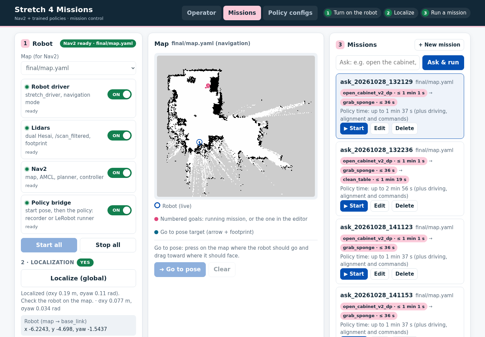

# Overview

*stretch4_mission* runs multi-step missions on the Stretch 4 mobile manipulator (ROS 2 Jazzy, `rmw_zenoh_cpp`) from a web UI. A mission drives the robot with Nav2 to each station, aligns it to a saved lidar reference, and runs a learned policy, a shell command, or nothing there. Missions are made in the editor, or from a sentence: Claude plans one from the policy configs and saved missions on the map, and the **Operator** tab lets anyone ask the robot for a task in plain words (see [Operator and text requests](docs/operator.md)). It is an independent project built on the Stretch 4 ROS 2 packages (`stretch_core`, `stretch_nav2`); it is not maintained by Hello Robot Inc.



A **mission** is a map plus ordered **steps**. The three step types can be combined in any order, for example "clean the table": open cabinet → pick sponge → clean table. Every step starts with the same arm retract: **lift to 0.5 m and retract the arm (the order depends on the lift height) → stow the wrist**. Then:

| Step type | What it does after the arm retract |
|---|---|
| **Policy** | Check pose → Nav2 to the step goal if needed → verify arrival and a stopped base (lidar alignment when the step has a reference) → lift to the top → `/policy/start` (the start pose, then the policy with its [runner](docs/policy-steps.md#policy-runners)) → wait for `STOPPED` |
| **Navigate only** | Check pose → Nav2 to the step goal if needed → verify arrival and a stopped base (lidar alignment when the step has a reference) |
| **Command** | Run one shell line on the robot where it is (no driving), for example `python3 ~/scripts/wave.py`. Exit code 0 = success. See [Command steps](docs/command-steps.md). |

### Repository layout

| Resource | Description |
|---|---|
| [config/](config/) | Mission tuning (`mission.yaml`), the policy library (`policies.yaml`), policy runner settings (`policy_runner.yaml`), saved recording lengths (`policy_runtimes.json`) |
| [launch/](launch/) | `navigation.launch.py` (driver, lidars, Nav2, policy bridge) and `mission.launch.py` (one mission) |
| [missions/](missions/) | Missions, policy configs (`configs/`) and lidar reference scans (`scans/`) written by the UI (ignored by Git) |
| [scripts/](scripts/) | `run_ui_robot.sh`, the operator entry point |
| [stretch4_mission/](stretch4_mission/) | Python package: the nodes, the web UI (`web/index.html`) and the command-line tools |
| [test/](test/) | Pytest suite |

### Components it builds on

| Piece | Existing component |
|---|---|
| Navigation, AMCL, obstacle avoidance | `stretch_nav2` `navigation_mppi.launch.py` (also starts `stretch_driver` in `navigation` mode, the dual Hesai lidars and the footprint) |
| Global localization | AMCL `reinitialize_global_localization` + `request_nomotion_update`, Nav2 `spin` action |
| Goal | Nav2 `NavigateToPose` through `nav2_simple_commander.BasicNavigator` |
| Pose / stationary | TF2 `map` → `base_link`, `/wheel_odom` |
| Arm retract, lift up | `stretch_driver`'s `/follow_joint_trajectory`, one joint at a time |
| Policies | `policy_bridge` (this package) behind `/policy/start`, `/policy/stop` and `/policy/status`, with two runners: `stretch4_policy_recorder` or `lerobot_stretch4` (see [Policy runners](docs/policy-steps.md#policy-runners)) |

## Quickstart

On the robot, build the package, check the robot, then start the UI:

```bash
cd ~/ament_ws/src
git clone git@github.com:JLUAS/stretch4_mission.git
cd ~/ament_ws
source /opt/ros/jazzy/setup.bash
colcon build --packages-select stretch4_mission
source install/setup.bash
ros2 run stretch4_mission check_robot
~/ament_ws/src/stretch4_mission/scripts/run_ui_robot.sh
```

From your computer, open an SSH tunnel and then http://localhost:8090:

```bash
ssh -N -L 8090:localhost:8090 hello-robot@<robot-ip>
```

**NOTE**: Home the robot, clear the area and keep a person with the physical stop next to the robot before you start a mission. The robot spins in place to localize and lifts to the top before every policy.

## Documentation

| Document | What it covers |
|---|---|
| [Installation](docs/installation.md) | One-time setup on the robot (policy runners, policies, build, text requests), and `check_robot` before each session |
| [Web UI and missions](docs/web-ui.md) | Starting the robot from the UI, localizing, creating and running missions, the mission file format, what every step does |
| [Policy steps](docs/policy-steps.md) | Policy configs, the two policy runners (`recorder`, `lerobot`), adding policies (`sync_policies`), policy run time |
| [Navigate steps](docs/navigate-steps.md) | Navigation and lidar alignment, Go to pose |
| [Command steps](docs/command-steps.md) | Shell commands run on the robot as a mission step |
| [Operator and text requests](docs/operator.md) | The Operator tab for end users, and missions planned by Claude from a sentence |
| [Reference](docs/reference.md) | Nodes, parameters, topics, services, launch files, running without the UI |
| [Safety](docs/safety.md) | Controller arbitration and failure behaviour |

## Testing

The pytest suite in */test* needs no robot. Run it with colcon:

```bash
$ cd ~/ament_ws
$ colcon test --packages-select stretch4_mission
$ colcon test-result --verbose
```

Or directly, from the package source:

```bash
$ cd ~/ament_ws/src/stretch4_mission
$ python3 -m pytest -q
```

## License

Apache 2.0. Please see the [LICENSE](./LICENSE) file.
