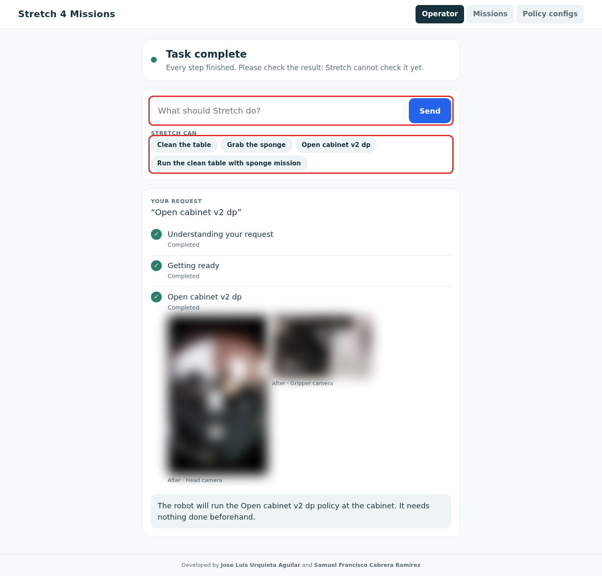

# Operator and text requests

A sentence in, a mission out: the **Operator** tab for end users, and **Ask & run** in the Missions tab, both planned by Claude from what is set up on the map.

## Operator

The **Operator** tab is for the person who only wants the task done. Nothing else on the page is shown there, and it has its own light design. Without the admin login it is the only view, and the server refuses everything else (see [Operators and admins](web-ui.md#operators-and-admins)). It shows:

- **The robot's status**, in words: *Ready to help*, *Working on your task*, *Task complete*, *Needs your help* (the request cannot be done, or something went wrong, with the reason) and *Task stopped*.
- **A text box**, and under it **Stretch can**: up to four example requests built from what is set up on the map (each policy config's task from `config/policies.yaml`, then the saved missions). A click puts one in the box.
- While it works: **your request**, then the steps in plain words: *Understanding your request*, *Getting ready* (which part it is starting, or finding where it is), then one line per mission step, from the policy's task and the config's or step's label: *Heading to the dining table* → *Lining up at the dining table* → *Clean the table*. Each step is *Completed*, *Working on this now* or *Up next*, taken from the live mission state; nothing is estimated or animated.
- **Pictures after each policy step** (`recorder` runner): under the finished step, *After · Head camera* and *After · Gripper camera*, so the person sees how things look once the policy is done. See below.
- **Stop task**, large, while it works.

The pictures are taken when a `recorder` policy stops: after `stretch4_policy_exec` has stopped (the robot is still) and before `stretch4_policy_stream` does, the bridge reads one frame of each camera in `snapshot_cameras` (`config/policy_runner.yaml`, default `[head_right, gripper]`) from the stream it already runs (`stretch4_mission/snapshot.py`, with the recorder's `.venv`). It only listens to the stream, so it never opens a camera or slows the policy. They are saved in `~/.ros/stretch4_mission/snapshots/<run>/` and served only from there. A `lerobot` policy has no stream to read, so its steps have no pictures; a failed picture is a warning in the bridge log, never a failed step.

When the request cannot be done, the answer says why and what Stretch can do instead. *Task complete* means every step finished: Stretch cannot yet check that the task succeeded, so the status asks the person to check the result.

When a request is sent, the robot gets itself ready and runs it:

1. **Understanding the request:** Claude plans it as a [text request](#text-requests), on the map Nav2 runs; with Nav2 off, on the map with the most policy configs and missions (the default map on a tie). If the request cannot be done, the answer says why and nothing starts or moves.
2. **Starting** each part that is off, in order: robot driver, lidars, Nav2 (on that map), policy bridge. Each one must answer (the same checks as the Robot panel) before the next starts, within 120 s.
3. **Localizing** if the robot is not localized: global localization, so the robot turns in place.
4. **Doing the task:** the planned mission runs, and its current step and phase show in plain words. The answer says when it is done, or why it stopped.

**Stop task** cancels whatever comes next: a turn in progress, and a running mission (Ctrl-C, as **Stop mission**). Parts already started keep running. It is a software stop, not a substitute for the robot's emergency stop.

**NOTE**: From the Operator tab the robot starts its driver, turns in place to localize and runs the plan without a confirmation. Home the robot before, clear the area, and keep the physical stop within reach.

## Text requests

Type a request in **Ask & run** (above the mission list), for example "go to the kitchen, then open the cabinet". Claude (`claude-opus-5-5`) builds a mission from the policy configs and saved missions on the map Nav2 runs, the UI saves it as `missions/ask_<time>.yaml`, and starts it at once. It shows in the mission list, so it can be edited, run again or deleted like any other.

Claude can only combine what is already set up: it answers with structured output whose step ids are an enum of a catalog built from the policy configs and saved missions on that map:

| Catalog entry | From |
|---|---|
| `config:<name>` | Every policy config on the map: the robot drives to its station, aligns, and runs the policy. A policy with no config cannot run. |
| `mission:<name>` | A whole saved mission |
| `navigate:<mission>:<n>` | A place: the goal of a navigate step |
| `command:<mission>:<n>` | A command step, word for word |
| `policy:<mission>:<n>` | An older policy step written inside a mission (until it is converted into a config) |

It never writes a goal, a pose or a command. Any request is accepted, in any language; planning is all or nothing: when any part of the request cannot be done with the saved steps, nothing runs and the UI shows that the mission cannot be completed and which part the robot cannot do. Give configs and steps a `label` ("kitchen cabinet", "wave"): it is the name Claude matches the request against.

Claude also works out what the request needs but does not say. Before planning it thinks through what each step needs and what it leaves done, and adds the steps that provide a missing need, in order: "clean the table" becomes open the floor cabinet → grab the sponge → clean the table, and the reply says why each extra step was added. It assumes nothing is done yet unless the request says so ("the cabinet is already open"). Common sense covers obvious needs; for the ones that depend on the site (where the sponge is kept), write them in each config's **Needs** and **Leaves**, so the chain comes from you and not from a guess:

| Config | Needs | Leaves |
|---|---|---|
| `open_floor_cabinet` | | the floor cabinet doors open |
| `grab_sponge` | the floor cabinet doors open | a sponge held in the gripper |
| `clean_table` | a sponge held in the gripper | the table clean |

When a needed step does not exist as a config, nothing runs and the reply says what is missing. The robot must be ready to run a mission (Nav2 on the map, every part ready, localized) before a request is sent; each request is one Messages API call, billed to the key's account.

**NOTE**: The plan runs without a confirmation, including command steps chosen from the saved missions. Save in missions only commands you want a text request to be able to run, and keep the physical stop within reach.

Setup: the planner venv and the API key, once per robot ([Installation](installation.md#one-time-setup-on-the-robot), step 5).

| Message under **Ask & run** | Fix |
|---|---|
| `…/.venvs/stretch4_planner/bin/python not found` | The planner venv is missing: run the two venv commands of [Installation](installation.md#one-time-setup-on-the-robot), step 5. No UI restart needed. |
| `no Anthropic API key found` / `no valid Anthropic API key` | Put the key in `~/.config/stretch4_mission/anthropic_api_key` (`chmod 600`), or check it in the Claude Console. |
| `cannot reach api.anthropic.com` | The robot has no internet: text requests need HTTPS to `api.anthropic.com`. |
| `Nothing set up on <map>` | No policy configs and no missions on the map Nav2 runs: create configs in the **Policy configs** tab. Older missions with the policy written inside the step still count; their **Convert to a policy config** button (in the mission editor) turns each step into a config. |
| `Start Nav2 on the map first` / `Not ready: …` / `Localize the robot first` | A request is only sent when a mission could start right away; do steps 1-2 of [Using the web UI](web-ui.md#using-the-web-ui). |
| The mission cannot be completed … | Not an error: the request needs something no config, place or command on this map provides (the reply says what). Add that config, or ask for less. |
| `rate limited by the Anthropic API` | Wait a minute and ask again. |

`stretch4_mission/planner.py` is the only part that talks to the model (input: the request and the catalog; output: one JSON line `{"plan", "message"}`), so moving to another model changes only that file. The UI parameters `planner_python` and `planner_model` select the venv and the model.
