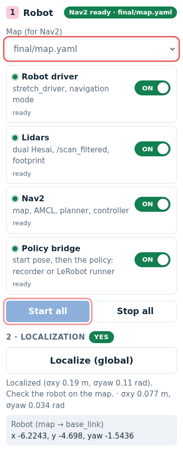
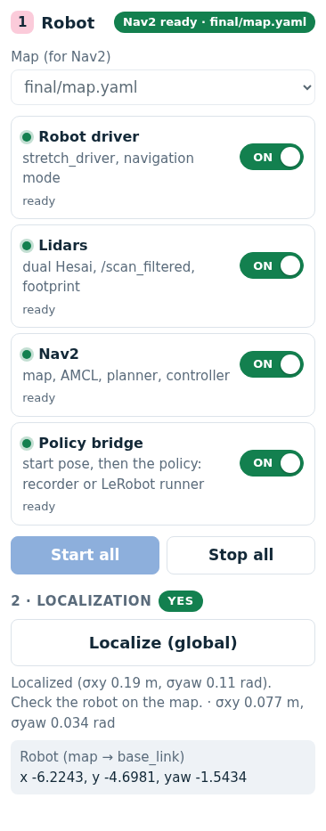
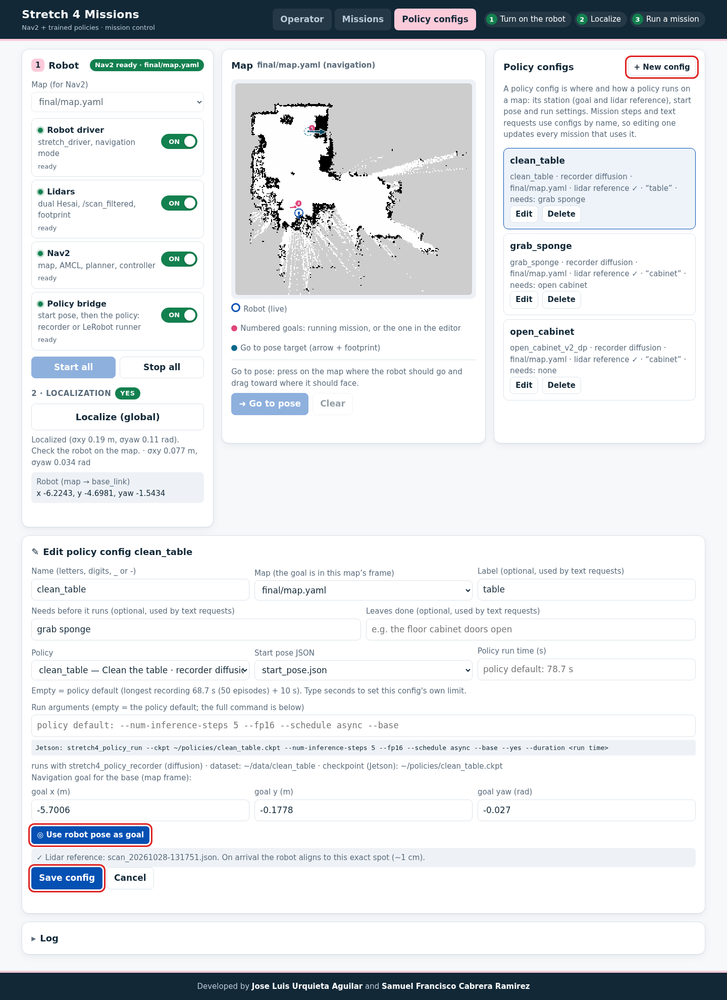
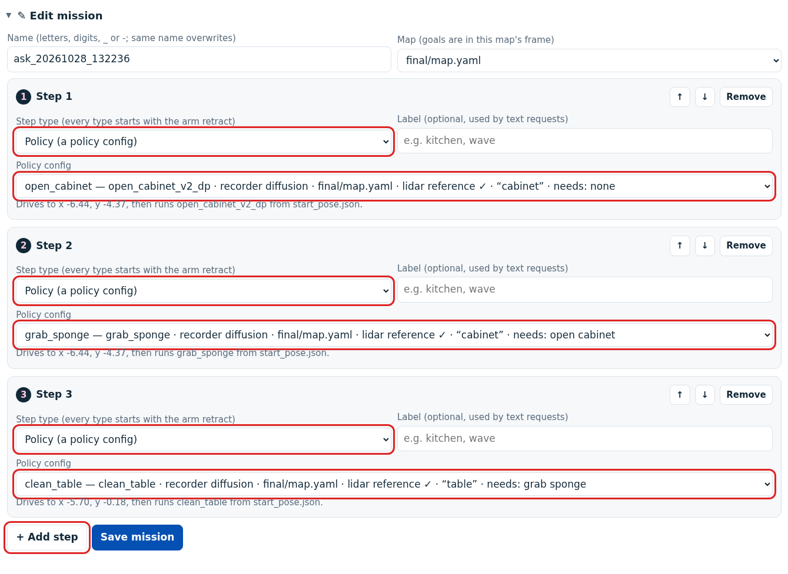
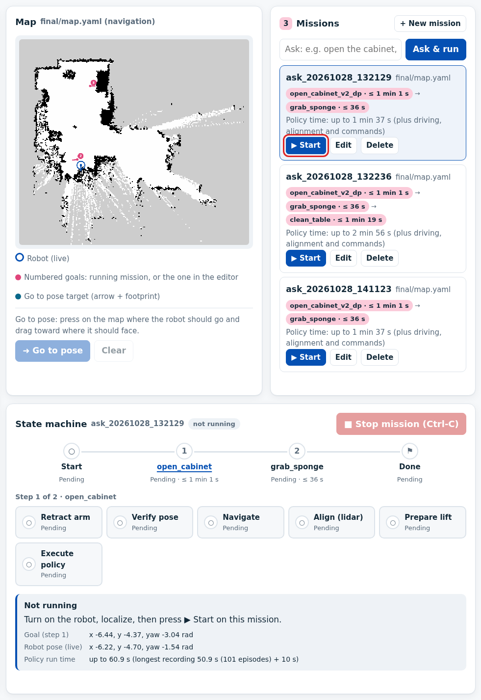

# Web UI and missions

How to run the robot from the web UI, and what a mission file holds. The three step types each have their own page: [policy steps](policy-steps.md), [navigate steps](navigate-steps.md) and [command steps](command-steps.md).

## Using the web UI

The page has three tabs: **Operator** (one sentence, the robot does the rest; see [Operator](operator.md#operator)), **Missions** (the steps below) and **Policy configs** (see [Policy configs](policy-steps.md#policy-configs)).

Start it on the robot (the script loads the same environment as `~/.bashrc`, so it also works from a plain `ssh` command):

```bash
~/ament_ws/src/stretch4_mission/scripts/run_ui_robot.sh
```

The script uses this robot's ID, adds new policies to `config/policies.yaml` (`sync_policies`), preselects `$HELLO_FLEET_PATH/maps/test.yaml` and turns RViz off. The UI listens only on the robot itself (`127.0.0.1:8090`); reach it through the SSH tunnel from the [Quickstart](../README.md#quickstart). Extra arguments go to the node: for example `-p host:=0.0.0.0` serves the whole network at `http://<robot-ip>:8090`.

**NOTE**: The UI has no login. Anyone who can reach its port can move the robot and, with command steps, run any shell command on it as the robot's user. Keep the default `host` (`127.0.0.1`) and use an SSH tunnel, or use it only on a trusted lab network.

1. **Robot:** choose the map, then **Start all**, or start each part with its own button: **Robot driver**, **Lidars**, **Nav2** (on the selected map) and **Policy bridge**. Together they are what `stretch_nav2`'s `navigation_mppi.launch.py` starts (same included launch files and arguments), plus the bridge. Each row shows whether that part really works, not just whether its process exists: the driver's `/follow_joint_trajectory` action and `/joint_states`, fresh `/scan_filtered`, Nav2's `navigate_to_pose`, the bridge's `/policy/status`. Green = ready, yellow = started but not responding yet. A part already running outside the UI shows as "started from a terminal", and the UI does not start a second copy. Stop buttons send Ctrl-C and are disabled while a mission runs. Each part has its own log (selector at the bottom).

   

2. **Localize (global):** AMCL spreads its guesses over the whole map, and the robot rotates in place (Nav2 `spin`, collision-checked, up to 3 turns) until the estimate converges (σxy ≤ 0.25 m, σyaw ≤ 0.30 rad). Check that the blue robot on the map is where the real robot is; in rooms that look alike AMCL can converge to the wrong place.

   

3. **Set up the policies** in the **Policy configs** tab (top of the page), once per policy and station. See [Policy configs](policy-steps.md#policy-configs).

   
4. **Create a mission** in the **Missions** tab:
   1. Click **+ New mission**, give it a name and pick the map.
   2. Click **+ Add step** and pick its **Step type**: *Policy*, *Navigate only* or *Command on the robot*. A policy step picks a **policy config**; its station, start pose and run settings come from that config.
   3. For navigate steps, drive the robot (gamepad) to where it should stop, then click **Use robot pose as goal** (it captures a lidar reference, as for a config). Goals appear as numbered arrows on the map.
   4. For command steps, type the **Command** (one line) and, optionally, a **Timeout (s)**. See [Command steps](command-steps.md).
   5. Optionally give steps a **Label**, the name [text requests](operator.md#text-requests) use for them. Reorder steps with ↑ ↓, then **Save mission**.

   

5. **Start** the mission, or type a [text request](operator.md#text-requests) in **Ask & run**. The state machine shows every step and phase live: pending, active (blue), done (green), skipped (dashed, for example navigation when already in place) and failed (red). Each step shows only the phases of its type. **Stop mission** sends Ctrl-C, and the mission cancels whatever it was doing. Navigation keeps running, so you can start another mission.

   

A mission only starts when Nav2 (started from the UI) runs on **its** map, the driver, lidars and bridge are ready, and the robot is localized. The UI says which part is missing.

**Go to pose** (under the map) drives the robot to any spot without a mission: press on the map where it should go and drag toward where it should face (a teal arrow), then click **Go to pose**. The robot stows the arm with stretch_nav_webapp's stow (the robot's own stow pose; the robot must be homed), then Nav2 drives there through the webapp's NavigateToPose client. It shows in the state machine as a one-step navigate mission (alignment skipped), and **Stop mission** stops it. It needs the same as a mission: Nav2 on the map shown, every part ready, the robot localized. From a terminal: `ros2 launch stretch4_mission mission.launch.py navigation:=false goal:=x,y,yaw`.

## Missions

Missions are saved by the UI in `missions/<name>.yaml` (`name`, `map`, `steps`). Each step has a `type` (missing = `policy`, as in older files):

| Type | Keys |
|---|---|
| `policy` | `config`: the name of a [policy config](policy-steps.md#policy-configs) on the mission's map. Older files may instead hold `policy`, `start_pose`, `goal`, `scan`, `max_runtime_sec` and `run_args` in the step; they still run, and the editor converts them into a config. |
| `navigate` | `goal: {x, y, yaw}`, `scan` |
| `command` | `command` (one line), optional `timeout_sec` |

Every step can also have a `label` (one line, up to 60 characters), the name [text requests](operator.md#text-requests) use for it: "kitchen" for a navigate step, "wave" for a command step.

## What every step does

- **Arm and lift moves are judged on the measured joint**, not on the driver's action result. `stretch_driver` only finishes a trajectory after the joint has *started* moving, so a goal at the current position (arm already retracted, lift already at its top) would never finish. A joint already in place is skipped ("already there"), a move counts as done once the joint is in place and still (a goal the driver keeps tracking is cancelled), and a driver error fails the step at once.
- **At the start of every step (policy, navigate and command), the arm retracts and the lift moves to 0.5 m.** With the lift below 0.5 m it lifts first, then retracts; at or above 0.5 m it retracts first, then lowers. **Then the wrist moves to the SG4 stow orientation** (yaw 3.14, roll 0, pitch 0). The gripper is not commanded, so a held object stays held. `retract_arm_before_navigation: false` in `config/mission.yaml` turns this off for every step type.
